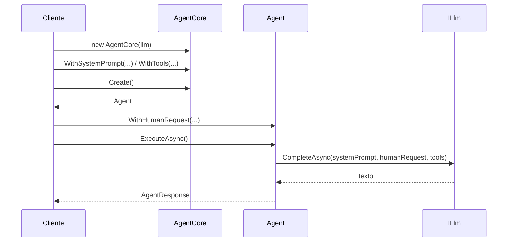

# jsn.agent.library

Biblioteca de agents em .NET 10, com as camadas domain e infra e testes xUnit.

Parte do projeto `agents-pipeline`. O `domain` tem o esqueleto do catálogo de agents; o `infra` ainda não tem código.

## Estrutura

| Projeto | Função |
| --- | --- |
| `src/jsn.agent.library.domain` | Camada de domínio |
| `src/jsn.agent.library.infra` | Camada de infraestrutura; referencia o domain |
| `tests/jsn.agent.library.domain.tests` | Testes xUnit do domain |

## Organização do domain

O `domain` é organizado por funcionalidade de negócio (DDD), não por tipo técnico. Há um único bounded context, o catálogo de agents, e o aggregate root é `AgentDefinition`.

| Pasta | Funcionalidade |
| --- | --- |
| `Authoring` | Definir um agent: `AgentDefinition` (aggregate root), nome, instruções, modelo, ferramentas, capacidades e o repositório |
| `Publishing` | Publicar versões imutáveis: `AgentVersion`, `SemanticVersion` e o evento `AgentVersionPublished` |
| `Retirement` | Descontinuar um agent: `AgentDefinitionDeprecated` |
| `Discovery` | Buscar agents por capacidade e estado: `AgentSearchSpecification` e `IAgentCatalog` |
| `SharedKernel` | Blocos base do DDD: `Entity`, `AggregateRoot`, `ValueObject`, eventos e exceção de domínio |

Os testes seguem as mesmas pastas.

## Diagrama da estrutura

### Projetos da solution

```
┌─────────────────────────────────┐
│ jsn.agent.library.domain.tests  │  xUnit · FluentAssertions 7 · Moq.AutoMock
└───────────────┬─────────────────┘
                │ referencia
                ▼
┌─────────────────────────────────┐        ┌─────────────────────────────────┐
│    jsn.agent.library.domain     │◄───────│     jsn.agent.library.infra     │
│  (regras de negócio, sem deps)  │ refer. │  (vazia: ainda sem código)      │
└─────────────────────────────────┘        └─────────────────────────────────┘
```

### Domain

O domain tem dois blocos que ainda não se ligam um ao outro: a execução do agent e a definição e o ciclo de vida.

```
jsn.agent.library.domain
│
├── EXECUÇÃO (raiz do projeto)
│     AgentCore ──Create()──► Agent ──ExecuteAsync()──► AgentResponse
│        │                      │
│        └──── usam ────────────┴──► ILlm      (CompleteAsync)
│                                 └─► ITool    (sem membros)
│
└── DEFINIÇÃO / CICLO DE VIDA (DDD, por funcionalidade)
      ├── Authoring    AgentDefinition (aggregate root)
      │                  ├─ AgentId · AgentName · Instructions
      │                  ├─ ModelSpec · Capability · ToolReference
      │                  ├─ AgentStatus (enum)
      │                  ├─ IAgentDefinitionRepository
      │                  └─ evento: AgentDefinitionCreated
      ├── Publishing   AgentVersion (entity) · SemanticVersion
      │                  └─ evento: AgentVersionPublished
      ├── Retirement   evento: AgentDefinitionDeprecated
      ├── Discovery    AgentSearchSpecification · IAgentCatalog
      └── SharedKernel Entity · AggregateRoot · ValueObject
                       IDomainEvent · DomainException
```

### Fluxo de execução



## Requisitos

.NET SDK 10. O `global.json` fixa o SDK 10.0.112 e aceita versões mais novas do SDK 10.

## Compilar e testar

```bash
dotnet build jsn.agent.library.slnx
dotnet test jsn.agent.library.slnx
```

## Licença

[MIT](LICENSE)

## Histórico de versões

Veja o [CHANGELOG](CHANGELOG.md).
