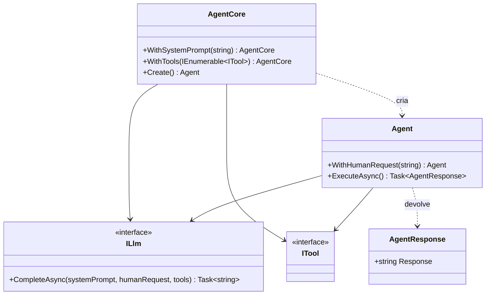

# jsn.agent.library

Biblioteca de agents em .NET 10, com as camadas domain e infra e testes xUnit.

Parte do projeto `agents-pipeline`. O `domain` tem o componente agent; o `infra` ainda não tem código.

## Estrutura

| Projeto | Função |
| --- | --- |
| `src/jsn.agent.library.domain` | Camada de domínio |
| `src/jsn.agent.library.infra` | Camada de infraestrutura; referencia o domain |
| `tests/jsn.agent.library.domain.tests` | Testes xUnit do domain |

## Componente agent

O `domain` tem só o componente agent. `AgentCore` monta o agent com o system prompt e as tools; o `Agent` recebe o pedido e devolve um `AgentResponse`. O `ILlm` é a porta para o modelo de linguagem.

| Tipo | Função |
| --- | --- |
| `AgentCore` | Criador do agent: `WithSystemPrompt`, `WithTools` e `Create()` |
| `Agent` | Recebe o pedido com `WithHumanRequest` e executa com `ExecuteAsync` |
| `AgentResponse` | Resultado da execução, com o texto do LLM |
| `ILlm` | Porta para o modelo de linguagem: `CompleteAsync` |
| `ITool` | Ferramenta do agent (ainda sem membros) |

## Diagrama da estrutura



## Requisitos

.NET SDK 10. O `global.json` fixa o SDK 10.0.112 e aceita versões mais novas do SDK 10.

## Compilar e testar

```bash
dotnet build jsn.agent.library.slnx
dotnet test jsn.agent.library.slnx
```

## Licença

[MIT](LICENSE)

## Histórico de versões

Veja o [CHANGELOG](CHANGELOG.md).
